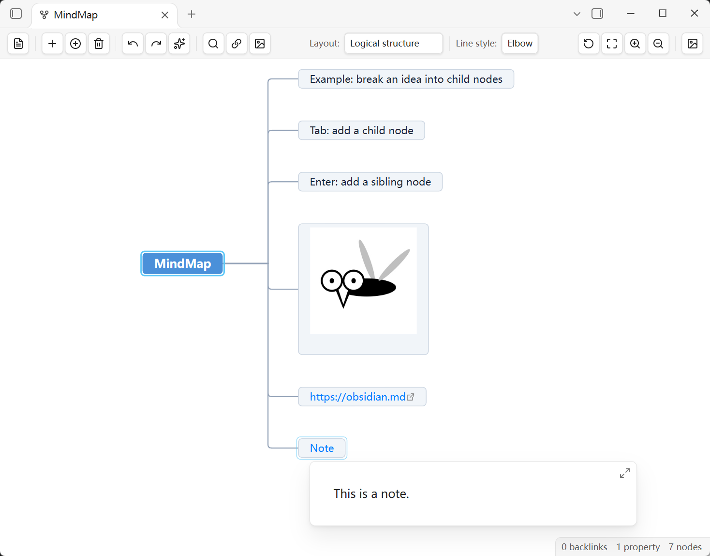
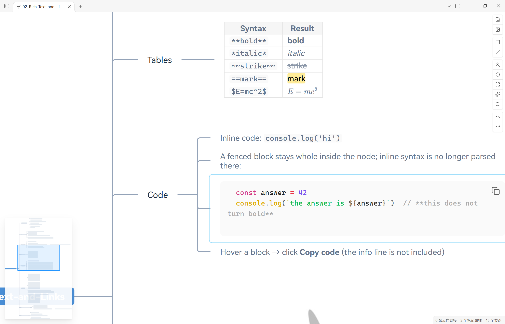

**English | [中文](README.zh-CN.md)**

<div align="center">

# 🧠 MindMap Studio

**Read and edit your notes as mind maps — the notes stay Markdown.**

Add `Mindmap: Mindmap` to a note's frontmatter and it opens as a mind map; any note can also be opened as one from its context menu. Nothing is converted and nothing is duplicated: the outline *is* the file, and every edit is written back into it.

Powered by the [simple-mind-map](https://github.com/wanglin2/mind-map) engine · by [WinterMosquito](https://github.com/WinterMosquito)

<p align="center">
  <a href="https://github.com/WinterMosquito/Obsidian-Mindmap-Studio/releases"></a>
  <a href="https://github.com/WinterMosquito/Obsidian-Mindmap-Studio/blob/main/LICENSE"></a>
  <a href="https://obsidian.md"></a>
  <a href="https://obsidian.md"></a>
</p>

</div>



## ✨ What it is — and what it isn't

MindMap Studio is a **rendering layer**, not a file-format converter. It reads a note's Markdown outline, draws it as a mind map, and writes your edits back as Markdown — so the note stays 100% standard Markdown, and links, backlinks, search and Git all work as usual.

| It is | It isn't |
|---|---|
| A mind-map **view** for notes you already have | A new note format or a separate app |
| **Markdown in, Markdown out** — frontmatter, headings and lists are the whole model | A converter that moves your content into `.xmind`-style files |
| The note as the single source of truth; the map is a way of looking at it | A second database that can drift from the file |

## 🚀 Features

### The file stays Markdown

- **Markdown-native**: a mind map is ordinary Markdown (a frontmatter declaration + headings + lists). No proprietary format, no special extension.
- **Round-trip fidelity**: unedited lines are written back verbatim (frontmatter preserved; blank lines between paragraphs and standalone `---` separators are normalised); headings `#`–`######` map to node levels 1–6, nested lists to deeper levels.
- **Central node ↔ filename**: editing the central node renames the file (Obsidian updates links/backlinks) — for **declared** mind maps only.
- **Persistence**: line style, palette, border and viewport are kept per file (in plugin data); the **layout** lives in the file's **own frontmatter** (`Mindmap` value — switching it rewrites that property). Whether a file *is* a mind map is the same declaration, so there is no second source of truth.

### Nodes look like your notes

- **Obsidian-native wikilinks**: `[[note]]` shows as its link text, with hover preview and graded modifier clicks (matching Obsidian).
  - **Modifier clicks**: plain click = current tab, `Ctrl`/`Command`+click = new tab, `+Alt` = new tab group, plus `Shift` = new window
  - **What the add-link dialog searches**: notes and other documents (`.canvas` / `.base`) plus non-image vault files (attachments); images go through **Add image**
  - **Links whose target does not exist yet** render in a **muted colour** (like Obsidian's reading view), resolved by the plugin from Obsidian's metadata cache; hover/click is left to Obsidian core (no pre-check on that path)
  - **New document links and images** follow Obsidian's own settings (the official **Use \[\[Wikilinks\]\]** governs links *and* images): with it on (the official default) they are written as `[[wikilinks]]` / `![[image]]` (document wikilinks render as clickable link text — no engine icon); with it off they are written as `[label](path.md)` / ``, and the document path form follows **New link format**. **Attachments** (PDFs, audio/video, archives — anything that is neither a document nor an image) always keep the wikilink embed form (`![[report.pdf]]` / `[[archive.zip]]`). **Existing** references keep the form they were written in — the setting never rewrites them (all three drop paths — with a node selected, with nothing selected, and folder drops — follow it; consolidated 2026-10-15)
  - **A node shows the alias** (the note name when there is none); editing the text of a pure wikilink node edits that alias and writes back `[[note|new alias]]`
  - **Dropping a vault file onto a node** (notes / images / attachments, **any type**), or picking one in the add-link dialog: a **completely empty node** is turned into a pure wikilink by writing the link's display name as its text; a node that already has **any content** (text, an image or an existing link — a pure-wikilink node included) keeps it, and the new link becomes a **child node**. A URL **on its own node** renders as **clickable address text** (the node has no text; the file still writes `<url>`)
- **Rich node content (clickable links + inline syntax)**: links inside a node render as **clickable text** — click to open, `Ctrl`/`Command`+click for a new tab (`+Alt` for a new tab group, plus `Shift` for a new window); **every link on a line is clickable** (no longer only the first one).
  - **Hover preview has two levels**: hovering **a specific link text** previews that link (important for multi-link lines and when the first link is an external URL); hovering **anywhere else on the node** previews the link the node carries (vault targets only)
  - **A URL mixed with other content is shown as a clickable address** instead of a bare icon
  - **Inline syntax** renders inside nodes the way Obsidian's reading view shows it: `**bold**` / `__bold__`, `*italic*` / `_italic_`, `` `inline code` `` (including double-backtick spans), `~~strikethrough~~`, `==highlight==`, `***bold italic***`; inline math `$…$` renders via MathJax, and `$$…$$` renders as a block (centred) formula — **multi-line** is supported too (falls back to the literal text until loaded); `\*escaped\*` / `\$` consume the backslash and show the literal character, and `%%comments%%` are hidden inside the node (kept in the file; a line that is nothing but a comment stays literal); a **GFM pipe table** (header row + separator row) renders as a real table — cells wrap within the node's content box and the table never overflows it (tables inside fenced code or block math stay literal)
  - **Task checkboxes**: a leading `- [ ]` / `- [x]` / `[X]` in a list item draws a checkbox inside the node that **toggles on a single click** (no edit mode needed); the write-back touches only the first three characters, keeps `[X]` as typed, and never triggers automatic link splitting. A body-less task still gets its checkbox; **nodes containing an image get none**, and no toggle entry either
  - **Tags**: `#tags` (including nested forms such as `#project/sub`) render as clickable pills that open Obsidian's tag search (`tag:#name`); only **top-level prose** counts (inline code / fenced code / math / comments / link internals excluded), and `foo#bar` / `#2024` are not tags; they are clickable in read-only embeds too, and **nothing is written back**
  - **Per-node colours**: right-click a node → **Palette** to recolour that node and **all of its descendants** (the value is a **base colour** — the fill is a light tint of it, **borders and connectors keep that colour**, text stays dark, **inline code, tables and links are recoloured to match**, and the **minimap follows**). The colour is written into that line as `%%#89CFF0%%`, **wins over** the file-wide palette, and a child's own directive **overrides** its ancestors'. **Default** returns the node to the **map palette** (even when a parent is coloured): if an ancestor is still coloured it writes `%%none%%` to block the inheritance, otherwise it simply removes the directive — `%%none%%` is the only non-colour value. With a multi-selection only the top-most nodes get a directive. **Custom** accepts a hex colour (`#89CFF0`) or RGB (`137, 207, 240`). The directive itself stays hidden (still a comment) and lives in the file; the same shape inside fenced/inline code or maths is not a directive, and invalid values stay plain comments. Right-clicking **empty canvas** → Palette changes the map-wide scheme instead (stored in `data.json`), and it also offers **Custom**
  - The raw text stays verbatim in the file; **links inside paragraph (multi-line) nodes are clickable too**
  - **Very long nodes** (> 2000 chars) show the beginning plus `…` (with a hover explanation) — the full text stays in the file, which also keeps oversized text from slowing the canvas down. Double-clicking such a node edits **the actual line from the file** (wikilink, URL and inline syntax stay visible and editable)
- **Images**: vault image suggestions, uniform sizing, `![[path]]` round-trip; drag the corner handle to resize a node image — the size is written back as Obsidian's official embed syntax (`![[img.png|300]]` width-only, `|300x150` explicit, `` for external images); clear a node's text and the node becomes image-exclusive — an image-exclusive node has no text, so node search never matches it. Inline images also render in **text/paragraph nodes** (its first line; links inside a paragraph are clickable too, see above). **With nothing selected**, pasting or dropping an image no longer asks you to select a node — each image becomes its own node under the central node.

### Read-only maps inside notes

- **Embedded read-only mind maps**: a fenced code block with the `mindmap` language renders in place as a read-only map (the block body uses the very same outline syntax as a mind map file). It behaves like Obsidian's built-in Mermaid: the container **fits the content** (scaled down to the note width, **never up**), **not draggable / zoomable / resizable**, and the wheel keeps scrolling the note. The preview writes neither the file nor plugin state; links inside nodes stay clickable and in-node code blocks stay copyable; above 500 nodes it degrades to a **read-only outline** with an in-block notice (see the [embedding section](#embedding-a-read-only-mind-map-in-a-note)).

### The canvas works like a canvas

- **Clipboard & node order**: `Ctrl`/`Cmd`+`C` / `X` / `V` copy, cut and paste a subtree as **plain Markdown outline text on the system clipboard** — the outline moves between the map and any editor (indentation encodes levels; headings flatten to `-` items; ordered items keep `1.`). The node context menu also has **Move node up** / **Move node down** — swap with the adjacent sibling, with a notice at the first/last position (one `Ctrl`/`Cmd`+`Z` undoes it). **With nothing selected**, `Ctrl`/`Cmd`+`C` copies the **whole map** (central topic as the first line) instead of asking you to select a node — the clipboard never keeps the previous, stale text.
- **Opens at 100%** with the whole map centred; **Reset zoom** returns to 100% while keeping the visible content in place (auto-arrange only re-lays out nodes and **keeps the current viewport** — use **fit to canvas** to see everything).
- **Controls sit on the map itself instead of a bar**: the right edge carries a vertical rail of icon buttons in four groups — back to Markdown / export image, **border** and **line style** (click to toggle; the icon *is* the current state), zoom in / reset zoom / fit to canvas / **auto arrange** / zoom out, undo / redo. Anything that **picks a value** lives in the **context menu**: right-click the canvas or a node → **Layout** / **Palette**, a cascading list with the current choice ticked. **Switching the layout writes it into the file's property** (six layouts — `Mindmap: <Layout>`; switching auto-arranges and fits the map), while **palette** (Default / Mint / Amber / Rose / Wisteria / Forest / Slate) is remembered per file in the plugin data, and so are **border** (Bordered / Borderless, borderless by default for new maps) and **line style** (Elbow / Curve, Elbow by default; Catalog organization / Timeline / Fishbone draw native straight connectors, so that toggle is disabled there).
- **Node search** is built in: `Ctrl`/`Cmd`+`F` opens a floating search bar with a live `current/matches` count (`Enter` next, `Shift+Enter` previous).
- **Large maps stay fast**: **performance mode** kicks in automatically (500+ nodes draws only the nodes in view — no setting) and **fast text node rendering** renders every text node through the plugin (large maps open several times faster; double-click then opens the inline editor).
- **Image export**: PNG or SVG, per the *Export format* setting; **maths survives export** — the MathJax faces the exported SVG actually uses are inlined on demand, so matrix rules, radicals, fraction lines and `cases` braces are not lost, at the cost of a larger file, and maps without maths are unaffected.
- **Drag reparenting**: drop a node onto another node to nest it as its child, or between two siblings to insert it in between (native engine hit-testing).
- **On maps with more than 2000 nodes, Fit to canvas has a readable floor**: when the true fit scale would be below 10%, the map is centred at 10% with a notice that not all nodes are shown (a multi-thousand-node fit lands around 0.03 — text under 1px).
- **Minimap**: when the map **does not fit the canvas at 100%**, a thumbnail fades in at the bottom-left (it disappears as soon as the map fits — **no button, command or setting**, and nothing is written to `data.json`): nodes are shaded by depth, connectors **follow the current layout's shape**, and colours follow the map. The box is the current viewport — drag it (or the empty area of the panel) to navigate, and it follows every pan/zoom frame. It fades out after 30 s without activity, stays while the pointer is over it, and wheel events over the minimap are forwarded to the canvas (plain wheel pans, `Ctrl`/`Cmd`+wheel zooms — same as on the map).
- **Status bar node count**: while the mind-map view is active the status bar shows "N nodes" (refreshed as you edit), and clears when you switch away or close the view.

## 🖼️ Feature gallery

**In the app**

**Task checkboxes and tags** — a leading `- [ ]` draws a checkbox inside the node (one click toggles it, and the write-back touches only the three leading characters), while `#tags` in the body render as clickable pills that open Obsidian's global search; shapes such as `foo#bar` and `#2024` stay plain text:

<p align="center">
  <a href="assets/Tasks%20and%20Tags%20Example.png"></a>
</p>

**Minimap** — it fades in when the map does not fit at 100%; the box is the current viewport, so drag it (or the empty area of the panel) to navigate:

<p align="center">
  <a href="assets/minimap.png"></a>
</p>

**Read-only embed** — a fenced block tagged `mindmap` renders in place in any note; it only scales down, cannot be dragged, and the wheel scrolls the page:

<p align="center">
  <a href="assets/Embed example.png"></a>
</p>

## 📖 Usage

### 1) Create & open a mind map
- Run **Create new mind map** (command palette or ribbon) → a naming dialog appears (default = prefix + date; duplicates get a numeric suffix) → the `MindMap2026-10-13.md` file is created and opens in the mind-map view. The folder follows the **Default location for new mind maps** setting — by default Obsidian's own "Default location for new notes". You can also **right-click any folder → Create new mind map** to create it right there.
- **Turn any note into a mind map**: add `Mindmap: Mindmap` to its frontmatter — the key is case-insensitive (the value too), and the note opens as a mind map as soon as it is opened. **The value is the layout**, so the same property also remembers how the map is drawn:

  | `Mindmap` value | Layout |
  |---|---|
  | `LogicalStructure` | Logical structure |
  | `Mindmap` | Mind map |
  | `OrganizationStructure` | Organization chart |
  | `CatalogOrganization` | Catalog organization |
  | `Timeline` | Timeline |
  | `Fishbone` | Fishbone |
  | `Markdown` | **Stop**: plain Markdown, no map |

  Values are tolerant (`mindMap`, `mind map`, `logical-structure` all work); an unknown value simply means "not a mind map". Set it to `Markdown` (or remove the property) to stop. **No renaming, no new file, no format conversion.** The legacy keys `Type` / `类型` are **no longer recognised** (since 2026-10-28): rename the property to `Mindmap` to bring an old file back. **Rolling back to an older build**: restore the older declaration shape first — rename the key `Mindmap` to `类型` (or `Type` in English vaults) and set the value to `Mindmap`. Older versions recognise neither the `Mindmap` key nor the layout enum values.
- **Any note becomes a mind map**: any `.md` file opens from its **context menu → Open as mind map** (or the same command), can be edited and saved back; the **first open writes the declaration** into the frontmatter (value = the **Default layout** setting, e.g. `Mindmap: LogicalStructure`), so the note is now officially a mind map and opens as one on its own next time (a note already declared is left untouched). A *declared* file instead shows **Open as Markdown** (which rewrites the property to `Markdown`, permanently).
- The command palette also lists **Create mind map in current folder**, **Search nodes**, **Fit to canvas**, **Arrange mind map** and **Export image** — the same actions as the on-map rail and the context menu.

### 2) How Markdown becomes a map
A mind map file is 100% standard Markdown — the plugin renders it as a mind map and writes your edits back. **The central node *is* the file name** (a virtual document root that corresponds to no line in the file); `#` headings start at **level 1**:

```markdown
---
Mindmap: Mindmap            ← declaration + layout (the value is the layout; same key in every UI language)
---
# Project plan              ← level-1 node (#)
## Goals                    ← level-2 node (##)
- Milestone 1               ← child node (list)
- Milestone 2
###### Details              ← level-6 heading
- Seventh-level item        ← list nested under a heading → level 7
```

> `#`–`######` → node levels 1–6 · nested lists go deeper · `[[note]]` / `[[note|alias]]` → clickable link (the node shows the alias) · bare URLs → clickable address · inline syntax renders inside nodes (`**bold**` / `__bold__`, `*italic*` / `_italic_`, `` `inline code` ``, `~~strikethrough~~`, `==highlight==`, `***bold italic***`; `$…$` inline math and `$$…$$` block formulas (multi-line included) render via MathJax; `\*escaped\*` / `\$` show literally and `%%comments%%` are hidden (a hex colour inside becomes a per-node colour directive — see above) — a comment-only line stays literal; a GFM pipe table renders as a real table) · `![[img]]` → image (`|300` sets the size) · paragraphs & fenced code stay as text (**links inside paragraphs are clickable too**).
>
> Non-image embeds such as `![[report.pdf]]` render as **clickable text** (the file name) — alone on a node or mixed with other descriptive text alike: click the text to open it (PDF, audio, video), `Ctrl`/`Command`+click for a new tab; hovering the text triggers Obsidian's native preview as well. Neither is rendered inline — a mind-map node cannot host Obsidian's inline media view.
>
> **Files dragged in from your system** (images / PDFs / audio & video / notes / any other file): **images** work with or without a selected node — with one they become that node's image, with nothing selected each image gets its own node under the central node; **other files need a selected node first** (a notice appears otherwise) and are copied into the "default location for new attachments" and attached to that node (embeddable types are written as embeds `![[report.pdf]]`, everything else as links `[[archive.zip]]`); holding **`Ctrl` (Windows/Linux) / `Option` (macOS)** instead **skips the copy** and inserts an absolute link to the original location `[file name](file:///…)` (wrapped in `<…>` only when the path contains spaces or brackets; clicking opens it in your system's default app) — the same behaviour as Obsidian's drag & drop.

#### Embedding a read-only mind map in a note

The same outline can live **inside a note**: write a fenced code block with the `mindmap` language and the reading view / live preview renders the block body as a **read-only mind map**.

````md
```mindmap
# Project plan
## Goals
- Milestone 1
- Milestone 2
```
````

- **One syntax**: the block body is identical to a mind map file's body (headings + lists, one parser) — no second format, no new setting
- **Shaped like the built-in Mermaid**: the container **grows with its content** — scaled down to the note width (**never up**), so nothing is clipped and a small map leaves no empty frame; **not draggable, zoomable or resizable**; **the wheel still scrolls the note** (even with the pointer over the map)
- **Read-only, no side effects**: it writes neither the file nor the plugin's `data.json`; links inside nodes **stay clickable** (handled by Obsidian itself, so nothing opens twice) and in-node code blocks stay copyable
- **Appearance follows the defaults**: the border uses the **Default border style** setting and the palette stays **Default** — an embed has no current-file identity, so it ignores the per-map choices made from the rail and the context menu
- **Fallbacks are always visible**: above **500** nodes the block shows a read-only outline with an in-block notice; an empty block body or a render failure gets its own one-line notice — never silent
- The language key stays `mindmap` from 0.0.1, so **existing notes work again with no edits**; which plugin wins when two register the same key is undocumented upstream

### 3) Everyday actions (in the mind-map view)
| Want to | Do |
|---|---|
| Edit a node's text | Double-click the node (or press **F2**; text inputs keep F2; with **no node selected F2 belongs to Obsidian** = rename the file) to open the **inline editor**: every text node is plugin-rendered (**fast text node rendering** is always on, no setting) and you edit **the actual line from the file** — `[[wikilink]]`, URL and `**bold**` syntax stay visible and editable; `Enter` commits, `Shift+Enter` adds a line, `Esc` stops and keeps (clicking outside the editor or wheeling the canvas commits too), and saving writes that line back verbatim. **Right-click → Edit in dialog is the second entry point**: a multi-line dialog (`Ctrl`/`Cmd`+`Enter` confirms, `Esc` cancels) with a live "**the node will show**" preview; a **pure wikilink** node edits its **alias** there (saving writes `[[note\|new alias]]`) |
| Follow a link in a node | Click the link text (current tab); `Ctrl`/`Command`+click (new tab — anywhere on the node works, falling back to the node's own link), add `Alt` for a new tab group, add `Shift` for a new window; **middle-clicking** a link opens it in a new tab too; hover **that** link for Obsidian's native preview (unresolved targets are not previewed) |
| Add a child / sibling | Right-click the node → **Add child node** / **Add sibling node** (siblings also via Enter) |
| Delete a node | Right-click → **Delete node** |
| Add a link | Right-click the node → **Add link** (pick a vault note or paste a URL). A wikilink fills a **completely empty** node (text = display name); a node with any existing content (text, image or link) gets a linked child node; a URL on its own node renders as **clickable address text** (the file still writes `<url>`) |
| Add an image | Select a node → **Add image** (from vault, clipboard, or a file) |
| Paste an image | `Ctrl`/`Cmd`+`V` on the canvas: with a **selected node** it becomes that node's image; with **nothing selected** a new image node is created under the central node |
| Copy / cut / paste nodes | `Ctrl`/`Cmd`+`C` / `X` / `V` with a node selected: the subtree is written to the **system clipboard** as a plain Markdown outline (indentation = levels; headings flatten to `-`; ordered items keep `1.`) — paste it into any editor, or paste an outline back as child nodes of the selection. The central node is never cut (silent no-op). With **nothing selected**, `Ctrl`/`Cmd`+`V` pastes an outline as a new node under the central node (an image on the clipboard still wins — see above) |
| Attach by drag & drop | Drag **any vault file** from the file explorer onto a selected node — it becomes the node's link (completely empty node: text becomes the display name; a node with any existing content: a linked child node is created); dragging an image sets the node image. With nothing selected, each file gets its own node under the central node — **images included** (a dropped image becomes its own image node) |
| Drag files in from your system | **Images** can be dropped with or without a selected node: with one, they become that node's image; with nothing selected, each image gets its own node under the central node. **Other files** need a selected node first (otherwise a notice asks you to) — they are copied into the vault and attached by type (notes → wikilink, everything else → attachment; embeddable types are written as `![[report.pdf]]`). Hold **`Ctrl` (Win/Linux) / `Option` (mac)** to **skip the copy** and insert an absolute link `[file name](file:///…)` instead (wrapped in `<…>` only when the path contains spaces or brackets) |
| Rearrange | Drag onto another node (pointer inside it) to nest it as its child; drag between two siblings to insert in between (native engine hit-testing) |
| Move a node up / down | Right-click the node → **Move node up** / **Move node down** — swaps it with the adjacent sibling and goes through the normal auto-save (one `Ctrl`/`Cmd`+`Z` undoes it). The central node and the first/last position show a notice instead |
| Resize a node image | Hover the image, drag its bottom-right handle (aspect ratio preserved) |
| Resize a node's width | Drag the left/right edge of a **text node** (the cursor turns into a double arrow); the node's height is recomputed for the new width on release. Empty and image nodes have no such handle |
| View an image full screen | **Click a node image** (or right-click → **View image full screen**) for a window-filling lightbox: click anywhere / `Esc` closes it, the wheel zooms |
| Copy a node's code block | Hover a block-level code block → click **Copy code** (a brief ✓ appears; the fence info line is not included) |
| Make a node image-only | Clear the node's text: double-click → empty, or right-click → **Remove text** |
| Work on empty canvas | **Double-click** the canvas = create a node under the central node and start editing it (Obsidian Canvas' "double-click to add a card"); **right-click** the canvas = new node / paste node / reset zoom / fit to canvas / auto arrange / layout / palette / undo / redo |
| Clean the layout | **Right-hand rail (four groups)**: back to Markdown / export; **border** / **line style** one-click toggles (the icon *is* the current state); zoom in / reset zoom (100%) / fit to canvas / **auto arrange** / zoom out; undo / redo. **Right-click menu**: **layout** / **palette** as cascading lists (the current choice is ticked), plus reset zoom / fit to canvas / auto arrange / undo / redo. All four appearance choices are remembered per file |
| Find a node | Search bar (`Ctrl`/`Cmd`+`F`, or the **Search nodes** command) — it opens as a floating bar at the bottom: typing searches as you go (180 ms debounce) and the box shows a `current/matches` count; `Enter` next, `Shift+Enter` previous, `Esc` closes; zero matches shows "No matches" |
| Split a node's links | **Auto-split mixed links is off by default**; once enabled, editing such a node **splits automatically** — document/attachment links mixed with text move into child nodes (the node keeps its text; images and external URLs stay). Command **Split all mixed links in document** batch-processes the whole file, including untouched notes — the whole batch counts as one step, so **one `Ctrl`/`Command`+`Z` undoes it** |
| Export | Rail **export** (or the **Export image** command) — PNG or SVG, per the *Export format* setting; a map containing maths keeps its structures (fonts inlined on demand, so the file is larger) |
| Back to Markdown | **Switch to Markdown** (restores source/preview mode) |

**Keyboard shortcuts (in the mind-map view)**

| Keys | Action | When it is *not* intercepted |
|---|---|---|
| `Ctrl`/`Cmd`+`F` | Open the search box | — |
| `Ctrl`/`Cmd`+`Z` | Undo | — |
| `Ctrl`/`Cmd`+`Shift`+`Z` | Redo | — |
| `Ctrl`+`Y` | Redo | Windows/Linux only — macOS leaves `Cmd`+`Y` alone |
| `Ctrl`/`Cmd`+`C` / `X` | Copy / cut the selected node (system clipboard, Markdown outline) | Inside a text input, or with no node selected |
| `Ctrl`/`Cmd`+`V` | Paste as child node(s) of the selection — with nothing selected, as a new node under the central node (an image on the clipboard still becomes an image node, see the actions table) | Inside a text input |
| `F2` | Edit the selected node | With **no node selected** F2 belongs to Obsidian (rename the file); inside a text input F2 is left alone |
| `Delete` / `Backspace` | Delete the selected node | Inside a text input, while a node is being edited, or with no node selected |
| `Shift`+`1` | Fit to canvas | Inside a text input |
| `Shift`+`2` | Zoom to the selection (falls back to fit-to-canvas when nothing is selected) | Inside a text input |
| `Tab` / `Enter` | Add a child / sibling node | Handled by the engine, not by the plugin |

Undo/redo go through the engine's own history. Very large maps keep fewer undo steps, because the history is capped by a fixed memory budget rather than a fixed step count.

**Context menus** — right-click the canvas for view-level actions, right-click a node for node-level actions. Menus follow the plugin's UI language (English shown here, Chinese in [`README.zh-CN.md`](README.zh-CN.md)).

| Canvas (empty area) | Node |
|---|---|
|  |  |

### 4) Saving & persistence
- Unedited lines are written back **verbatim** (frontmatter preserved; blank lines between paragraphs and standalone `---` separators are normalised); editing a **pure wikilink** node (the whole line is one wikilink) edits its **alias**, written back as `[[note|new alias]]` (clearing the text drops the alias and keeps the link; nodes that mix text and a link still round-trip as "text + link").
- **The layout lives in the file's own property** (`Mindmap` — switching it from the context menu rewrites that property and never touches the body); line style, palette, border and viewport are kept per file in the plugin `data.json`. Whether a file **is** a mind map is the same declaration, so there is no second source of truth. Node image sizes go into the note itself as official embed syntax (`![[img|300]]`).
- Editing the **central node** renames the file (Obsidian updates links/backlinks); declared mind maps only.
- Only **one** mind-map editing instance per mind map (Obsidian itself lets you open the same file in as many tabs as you want): opening it in a second tab shows a notice and hands the view back, so two copies can never overwrite each other's saves. The note's reading view can still be open next to the mind map.
- If the file is changed **outside** Obsidian (sync folder, another window), auto-save skips that round with a one-time notice instead of overwriting the other change; after repeated write failures auto-save is suspended with a notice (manual save still works).
- Config is local; no telemetry, and the plugin makes **no outbound network requests** — nothing is sent anywhere. The only fetch it performs is a **local** `app://obsidian.md` read of the MathJax font files when you export a map that contains maths (see *image export* above); nothing leaves your machine.
- **Files outside the vault** are only ever touched when *you* ask for it: an absolute `file:///` link (created by holding `Ctrl`/`Option` while dropping a file) is handed to your system's default app when you click it. The plugin does not read, copy or upload those files.

### 5) Deliberate differences from Obsidian

The mind-map view is a **third kind of view** (neither reading nor editing view), so a few interactions follow this view's semantics. All of them are registered (see `AGENTS.md` K56 ⑤; the second-tab and side-button rows are K102 / K111):

| Item | Obsidian | This plugin |
|---|---|---|
| `F2` | Renames the current file | Same: with **no node selected** F2 goes to Obsidian (rename the file); with a node selected it edits that node (selecting the central node amounts to renaming the file, since its text *is* the file name) |
| Auto-update links on rename | Setting "Automatically update internal links" (on by default) | **Follows Obsidian's setting** (the plugin has no toggle of its own): with it off, links are left untouched (they become unresolved) and deleting no longer clears references; Obsidian itself already asks whether to update links after a rename, so the plugin no longer repeats that prompt (it only logs to the console) |
| Link syntax for new links | Follows the "Use \[\[Wikilinks\]\]" / "New link format" settings | Same, for **document links and images** (the official setting governs links *and* images): with Wikilinks on (the official default) it writes `[[wikilinks]]` / `![[image]]`; with Wikilinks off it writes `[label](path.md)` / ``; rewrites keep your existing path prefix. **Attachments** always keep the wikilink embed form (`![[report.pdf]]` / `[[archive.zip]]`) |
| `[[` suggestions | Inline suggestions in the editor | The source-line dialog is a plain textarea (no inline suggestions) → use the vault-file suggestions in the **Add link** dialog |
| Backlinks / Outgoing links / Unlinked mentions panes | Core plugins | Not duplicated — Obsidian's own panes act on the current file and work while the mind-map view is open |
| Clicking a non-renderable vault file (zip / docx / …) | Opens in the default system app | Same |
| Same file in a second tab | Allowed — "open as many tabs as you want"; `Ctrl`+clicking a link to a file that is already open makes a new tab | A notice appears and the view is handed back to the existing tab: one mind-map editing instance per mind map (two instances = two engines + two save pipelines, whose interleaved saves lose edits). The note's reading view can still be open alongside |
| Mouse side-button back / forward | Follows the navigation history | Same: side buttons follow Obsidian's navigation history in the mind-map view; switching views is **not** a navigation point — back goes straight to the previous navigation point (usually the previous note). Use **Switch to Markdown** (the rail's back button or the command palette), or **Open as Markdown** from the file context menu, to return to the note's Markdown view |

The full Markdown ↔ mind-map mapping rules live in [`docs/markdown-mindmap-standard.md`](docs/markdown-mindmap-standard.md).

## ⚙️ Settings

Everything lives in **Settings → MindMap Studio** (stored locally in the plugin's `data.json`; the table below follows the panel order):

| Setting | Default | Notes |
|---|---|---|
| Language | 中文 | UI language for the plugin's own labels and messages. It **never touches your files**: the mind-map declaration key is always `Mindmap`, whatever the UI language |
| Default layout | Logical structure | Used when creating a new mind map (six layouts: Logical structure / Mind map / Organization chart / Catalog organization / Timeline / Fishbone) |
| Default line style | Elbow | Used when creating a new mind map (Elbow / Curve; switchable only for Logical structure / Mind map / Organization chart — the other three layouts draw native straight connectors) |
| Default border style | Borderless | Border style for new mind maps (Bordered / Borderless; each map can toggle it anytime with the *border* button on its rail, and existing maps keep their own value) |
| Theme | Follow Obsidian | Light/dark palette for maps: Follow Obsidian / Force light / Force dark |
| Default location for new mind maps | Follow Obsidian setting | Where **Create new mind map** puts the file: Follow Obsidian setting / Vault folder / Same folder as current file / In the folder specified below |
| Target folder | (empty) | Used by the "specified folder" mode above only (**only visible for that mode**); an unresolvable folder falls back to the vault root (no folders are auto-created) |
| Auto-save | On | Writes edits to the note while you work |
| Auto-split mixed links | Off | When enabled, an edited node that mixes links with description text moves document/attachment links into child nodes (images and external URLs stay) — it rewrites the file structure, so it only happens once you opt in; use the command "Split all mixed links in document" for a whole file |
| Enable node dragging | On | Drag nodes to change hierarchy and order |
| Export image scale | 2 | PNG export resolution multiplier (slider 1–4; SVG export is vector and unaffected by it) |
| Export format | PNG | Format used by the **Export image** command and the rail's export button: PNG raster or SVG vector (SVG output is vector, so the scale above does not apply) |

> **Palette and border are not settings**: both are remembered per file and switched on the map itself — **border** from the rail, **palette** from the right-click menu (layout and line style work the same way); the settings panel only holds **Default border style**, which decides the border of **new** maps.
>
> **The following are now always on and no longer exposed as settings**: performance mode (500+ nodes draws only the nodes in view) and fast text node rendering (every text node is plugin-rendered; double-click opens the inline editor) — i.e. the previous "best default", so any earlier toggle choice is ignored. Reference updating (rename / delete) also lost its own toggle and now **follows Obsidian's "Automatically update internal links"** (on by default).

## 📦 Install

- **Community plugins**: **Settings → Community plugins** → search *MindMap Studio*.
- **From GitHub releases**: download the latest release assets (`main.js`, `manifest.json`, `styles.css`) from the repo [Releases](https://github.com/WinterMosquito/Obsidian-Mindmap-Studio/releases) page, copy them into `<vault>/.obsidian/plugins/mindmap-studio/`, reload Obsidian, then enable the plugin in **Settings → Community plugins**. (Each release also attaches `LICENSE` and `THIRD-PARTY-NOTICES.md` for licence compliance — no need to copy those into the plugin folder.)
- **Build from source**: `npm install && npm run build` produces `main.js`; copy it together with `manifest.json` and `styles.css` into the plugin folder.

> Release notes for each version live on the repo's [Releases](https://github.com/WinterMosquito/Obsidian-Mindmap-Studio/releases) page (their text comes from [`docs/release-notes-<version>.md`](docs/)).

> Requires Obsidian 1.13.0 or later. Desktop only (Windows, macOS, Linux). Config is stored locally (plugin `data.json`); no telemetry and no outbound network requests. `main.js` is built in CI and attached to each GitHub Release (it is not committed to the repo).

## 🛠 Development

```bash
npm install
npm run dev      # watch mode
npm run build    # type-check + production bundle (main.js)
npm test         # regression suite (vitest)
npm run lint     # ESLint (the official obsidianmd ruleset, warnings are errors)
npm run lint:css # stylesheet rules — mirrors the community-directory scanner's stylelint set
npm run check:release   # release metadata guard (versions.json / manifest / README)
npm run verify:visual   # headless-Chrome render & contract checks (add `-- --perf` for a real-clock baseline)
```

The engine (`vendor/simple-mind-map.cjs`) is vendored and must not be hand-edited; rebuild from upstream source when upgrading. Bundled third-party licences are listed in [`vendor/THIRD-PARTY-NOTICES.md`](vendor/THIRD-PARTY-NOTICES.md).

## ⚖️ License

MIT — see the `LICENSE` file in the repository root. The plugin bundles the [simple-mind-map](https://github.com/wanglin2/mind-map) engine and its dependencies under their own licences (MIT / BSD-3-Clause); those notices live in [`vendor/THIRD-PARTY-NOTICES.md`](vendor/THIRD-PARTY-NOTICES.md) and are attached — together with `LICENSE` — to every GitHub release, so the declarations accompany each distributed copy of the bundle.
