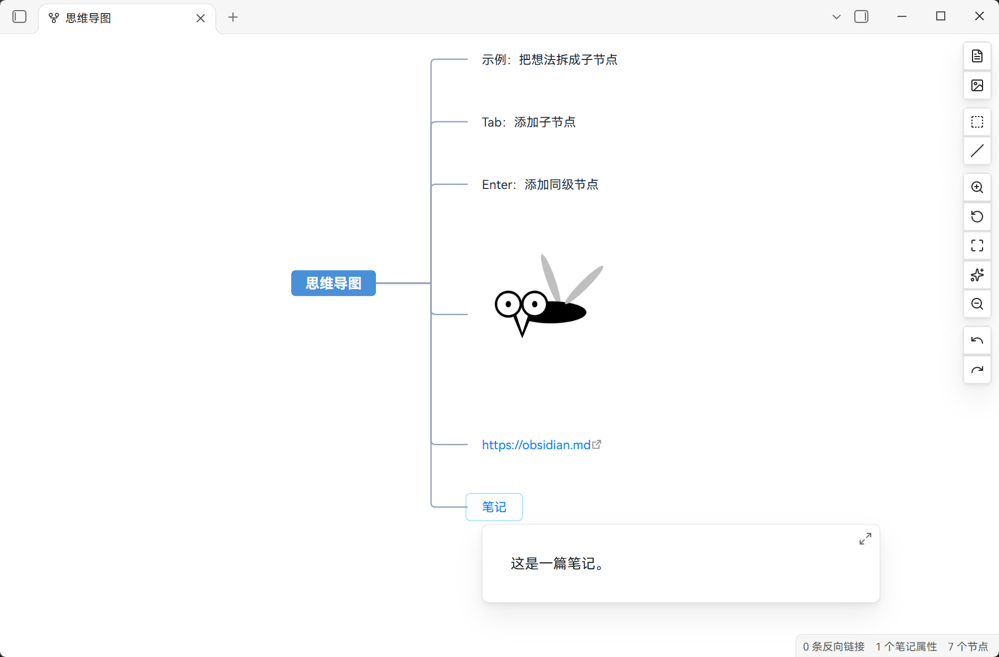
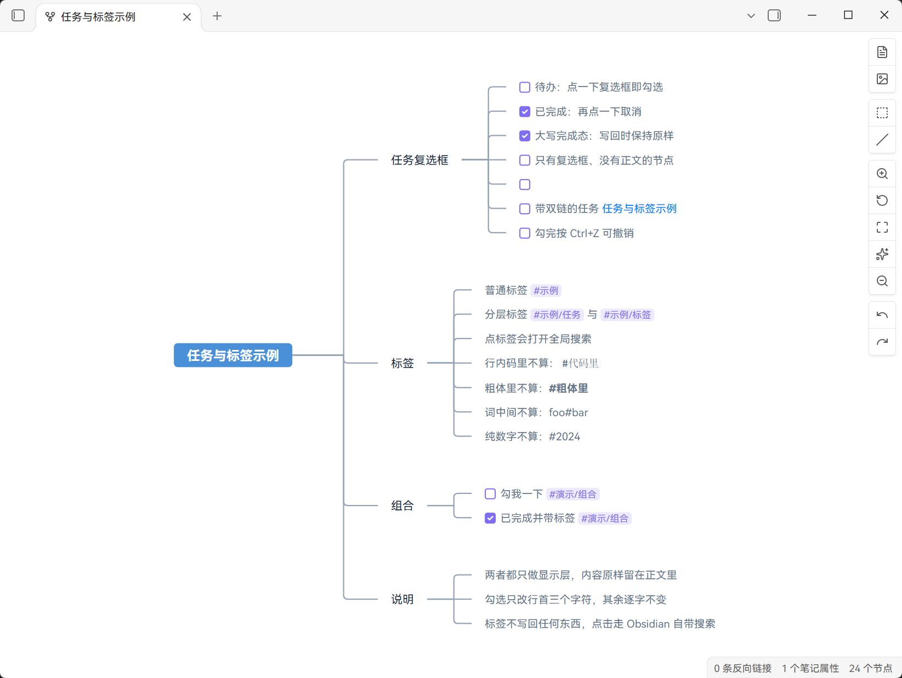
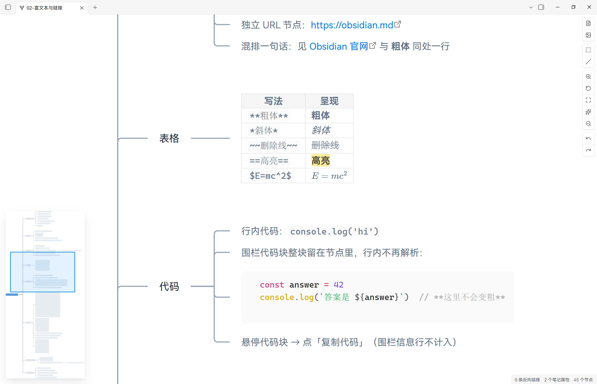
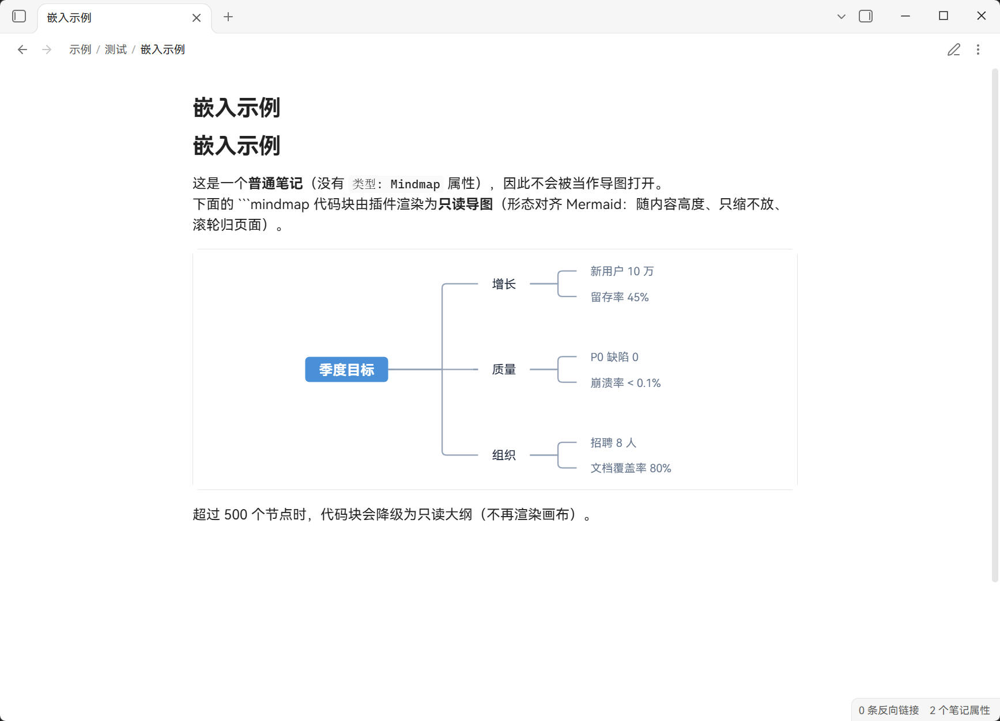
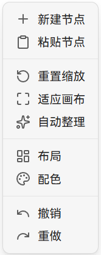
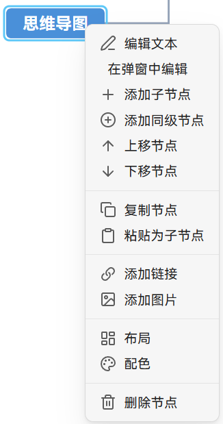

**[English](README.md) | 中文**

<div align="center">

# 🧠 MindMap Studio

**把笔记当作思维导图来读、来改 —— 而笔记仍然是 Markdown。**

在笔记的 frontmatter 写 `Mindmap: Mindmap`，它打开时即是导图；任何笔记也可用右键菜单的**「以思维导图打开」**打开。不转换格式、不复制副本：大纲*就是*文件本身，每一处编辑都写回其中。

基于 [simple-mind-map](https://github.com/wanglin2/mind-map) 引擎 · 由 [WinterMosquito](https://github.com/WinterMosquito) 开发

<p align="center">
  <a href="https://github.com/WinterMosquito/Obsidian-Mindmap-Studio/releases"></a>
  <a href="https://github.com/WinterMosquito/Obsidian-Mindmap-Studio/blob/main/LICENSE"></a>
  <a href="https://obsidian.md"></a>
  <a href="https://obsidian.md"></a>
</p>

</div>



## ✨ 它是什么 —— 以及它不是什么

MindMap Studio 是一个**渲染层**，而非格式转换器。它读取笔记的 Markdown 大纲、画成思维导图，再把你的编辑写回为 Markdown —— 笔记因此保持 100% 标准 Markdown，链接、反向链接、全文搜索与 Git 都照常生效。

| 它是 | 它不是 |
|---|---|
| 给**已有笔记**用的思维导图**视图** | 新的笔记格式，或另一个独立应用 |
| **Markdown 进、Markdown 出**——frontmatter、标题、列表就是全部数据模型 | 把内容搬进 `.xmind` 之类文件的转换器 |
| 笔记是唯一事实来源，导图只是看它的一种方式 | 可能与文件内容脱节的第二份数据库 |

## 🚀 功能特性

### 文件始终是 Markdown

- **纯 Markdown**：导图文件就是普通 Markdown（frontmatter 声明 + 标题 + 列表），无专有格式、无专用扩展名。
- **往返保真**：未编辑的行逐字回写（frontmatter 原样保留；段落间空行与独立的 `---` 分隔线会做规范化）；标题 `#`–`######` 对应导图第 1–6 级节点，缩进列表对应更深层级。
- **中心节点 ⇄ 文件名**：修改中心节点会自动重命名该文件（Obsidian 原生更新链接/反链）；仅对**声明为导图**的文件生效。
- **状态持久化**：每个文件的连线样式、配色、边框与视口会保存（插件 data.json）；**布局写在文件自己的属性**（`Mindmap` 的值，切换布局即改写该属性）。「是不是导图」由同一份属性决定，不存在第二份状态。

### 节点像笔记一样工作

- **Obsidian 原生双链**：`[[笔记]]` 显示为链接文本，支持悬停预览与逐级修饰键跳转（与 Obsidian 官方一致）。
  - **修饰键跳转**：普通点击＝当前标签、`Ctrl`/`Command`+点击＝新标签、`Ctrl`/`Command`+`Alt`+点击＝新标签组、再按 `Shift`＝新窗口
  - **添加链接的可选面**：联想笔记与其它文档（`.canvas` / `.base`）及非图片的库内文件（按附件处理）；图片请走「添加图片」
  - **指向尚不存在目标的链接**显示为**弱化配色**（同 Obsidian 阅读视图），由插件读 Obsidian 元数据缓存解析得出；悬停/点击路径不再预检，目标是否存在交 Obsidian 核心判断
  - **新增的文档链接与图片**跟随 Obsidian 自身设置（官方「使用 \[\[Wikilinks\]\]」**同时管 links 与 images**）：开启（官方默认）时写 `[[双链]]` / `![[图片]]`（文档双链渲染为可点链接文本，无引擎图标），关闭时写 `[显示名](路径.md)` / ``，文档路径形态跟随「New link format」；**附件**（PDF / 音视频 / 压缩包等非文档非图片）**始终**写 wikilink 嵌入形态（`![[报告.pdf]]` / `[[归档.zip]]`）。**既有**引用的形态按原文保真、不被该设置改写（拖入的三条路径——选中拖入、未选中拖入、文件夹拖入——**均**按此执行，2026-10-15 收口）
  - **节点内显示别名**（无别名时为笔记名）；纯双链节点里编辑节点文本即等于改别名，保存后回写为 `[[笔记|新别名]]`
  - **把库内文件拖到节点上**（笔记 / 图片 / 附件，**任意类型**），或在「添加链接」中选中双链：**完全空白**的节点会被写入链接显示名（成为纯双链节点）；**已有任何内容**的节点（文字、图片或原链接——纯双链节点也算）一律保留原样，链接建为**子节点**。URL **单独成节点**时显示为**可点地址文本**（无节点文本，文件里仍写作 `<网址>`）
- **节点内富文本（可点链接 + 行内语法）**：节点里的链接渲染为**可点文本**——点击即跳转，`Ctrl`/`Command`+点击在新标签打开（`+Alt` 新标签组、再 `+Shift` 新窗口）；**一行多枚链接各自可点**（不再只有第一枚生效）。
  - **悬停预览分两级**：悬停到**某枚链接文字上** → 预览那一枚（一行多链接、首链为外链时尤其重要）；悬停**节点其它位置** → 预览该节点承载的链接（库内目标才有弹窗）
  - **URL 与其它内容混排时显示为可点地址**（不再只是图标）
  - **行内语法**按 Obsidian 阅读视图口径在节点内呈现：`**粗体**` / `__粗体__`、`*斜体*` / `_斜体_`、`` `行内代码` ``（含双反引号跨度）、`~~删除线~~`、`==高亮==`、`***粗斜***`；行内数学 `$…$` 经 MathJax 渲染，`$$…$$` 渲染为块级（居中）公式——**可跨行**书写（加载完成前按字面显示）；`\*转义\*` / `\$` 消费反斜杠按字面显示；`%%注释%%` 整段隐藏（只在文件里保留；整行只有注释时按字面显示）；**GFM 管道表**（表头行 + 分隔行）渲染为真表格——单元格在内容盒内折行、表格不溢出节点（代码围栏与块级数学内的表格保持字面）
  - **任务复选框**：列表项首行的 `- [ ]` / `- [x]` / `[X]` 在节点里画出复选框，**点一下即切换**（不必进入编辑）；写回只改行首三个字符、`[X]` 原样保留，切换不触发自动拆链。空正文的任务也画复选框；**含图节点不画**，也不提供任何勾选入口
  - **标签**：`#标签`（含 `#项目/子项` 这类分层形态）渲染为可点 pill，点击打开 Obsidian 的标签搜索（`tag:#名`）；只认**顶层正文**（行内码 / 代码块 / 数学 / 注释 / 链接内部不算），`foo#bar`、`#2024` 不算；只读嵌入里同样可点，且**零写回**
  - **节点级配色**：右键节点 →「配色」即可给**该节点及全部子节点**换色（指令色是**主色**——画布上是大面积浅底、**边框与连线保留主色**、浅底上的深字，**行内代码、表格与链接也按底色自动配色**，**小地图同步**）；颜色以 `%%#89CFF0%%` 写进那一行 Markdown，**优先于**整篇配色，子节点自己写指令即**就近覆盖**。首项「**默认**」= 回到**整篇配色**（父节点染了色也一样）：上层还染着时会写成 `%%none%%` 挡住继承，否则直接删掉指令——`%%none%%` 也是唯一的非颜色值。多选时只给最上层节点写指令；末项「**自定义**」可填十六进制（`#89CFF0`）或 RGB（`137, 207, 240`）。指令本身不显示（仍按注释隐藏），只留在文件里；写进代码块/行内代码/数学里的同形态不算指令，值不合法的仍当普通注释。右键**空白处**的「配色」改的是整篇方案（存 `data.json`），同样支持「自定义」
  - 文件原文逐字保真；**段落（多行）节点里的链接同样可点**
  - **超长节点**（> 2000 字）只显示开头并以 `…` 标示（悬停有说明），完整内容仍在文件中——这同时避免了超长文本拖慢画布。双击这类节点编辑的是**文件里的那一行**（双链、URL、行内语法原样可见可改）
- **图片**：仓库内图片联想、统一尺寸、`![[路径]]` 往返；拖动右下角手柄即可调整节点图片大小，尺寸以 Obsidian 官方嵌入语法写回笔记（`![[图.png|300]]` 仅宽等比、`|300x150` 指定宽高、`` 外链图）；清空文本后节点被图片独占——该节点已无文本，故节点搜索不会命中它。**段落（文本）节点行内的图片同样会渲染**（取首行；段落里的链接同样可点，见上条）。**未选中节点**时粘贴 / 拖入的图片不再提示「请先选择节点」，而是各自在中心节点下新建一个图片节点。

### 笔记里的只读导图

- **笔记内嵌只读导图**：在任意笔记里写语言标识为 `mindmap` 的围栏代码块，即就地渲染为只读导图（块体与导图文件正文**同一份大纲语法**）——**形态对齐 Obsidian 内置的 Mermaid**：容器随内容（按笔记宽度等比缩放，**只缩不放**）、内容完整可见、**不可拖动 / 缩放 / 调大小**、滚轮照常滚动笔记；只读预览**不回写文件、不写插件状态**；节点内链接仍可点、块内代码块可复制；节点数超过 500 时降级为**只读大纲**并在块内提示（详见 [② 的嵌入小节](#在笔记里嵌入只读导图)）。

### 画布像画布一样工作

- **剪贴板与节点顺序**：`Ctrl`/`Cmd`+`C` / `X` / `V` 复制 / 剪切 / 粘贴子树——以**纯 Markdown 大纲文本写入系统剪贴板**（缩进表层级、标题降为 `-` 项、有序项保留 `1.`），可在导图与任意编辑器间搬运。节点右键另含**「上移节点」/「下移节点」**——与相邻兄弟交换，首/末位有提示（一步 `Ctrl`/`Cmd`+`Z` 可撤销）。**无选中时** `Ctrl`/`Cmd`+`C` 复制**整张图**（中心主题作首行），不再只弹「请先选择一个节点」——剪贴板不会留着上一次的旧内容。
- **打开即 100%** 且整图居中；点「重置缩放」回到 100%（屏幕上可见的内容保持原位；**自动整理只重排节点、保留当前视口**，想看全图按「总览」）。
- **控件直接贴在导图上，不再占一条横栏**：右侧是一列竖排图标（四组）——返回 Markdown / 导出图片、**边框**与**连线**（点一下互切，图标即当前状态）、放大 / 重置缩放 / 总览（适应画布）/ 整理 / 缩小、撤销 / 重做；**需要「选一个值」的都在右键菜单**（画布或节点右键 → **布局** / **配色**，级联列表里当前项打勾）。**切换布局会写进文件属性**（六种布局——`Mindmap: <布局>`，切换后自动整理并适应画布），**配色**（默认 / 薄荷 / 琥珀 / 玫瑰 / 紫藤 / 森林 / 石板）按文件记在插件 data.json；**边框**（有边框 / 无边框，新建默认无边框）与**连线**（折线 / 曲线，新建默认折线；目录组织图/时间轴/鱼骨图为布局固有直线，该开关置灰）同样按文件记忆。
- **节点搜索**内建：`Ctrl`/`Cmd`+`F` 弹出浮动搜索栏，输入即搜并显示 `当前/命中数`（`Enter` 下一个、`Shift+Enter` 上一个）。
- **大图依然顺手**：**性能模式**自动开启（节点数 ≥ 500 时只绘制视野内的节点——无设置项），**文本节点快速渲染**让所有含文字节点由插件渲染（打开大图快数倍；双击改为内联编辑）。
- **图片导出**：PNG / SVG，按设置「导出格式」；**含数学的图导出后结构不再丢失**——导出 SVG 里实际用到的 MathJax 字体按需内联，矩阵竖线 / 根号 / 分式线 / cases 大括号都保留，代价是文件变大，纯文本导图不受影响。
- **拖拽换父**——把节点拖到目标节点上即挂为其子节点，拖到两兄弟之间即插入其间（引擎原生落点判定）。
- **大图（> 2000 节点）的「适应画布」有可读下限**：真 fit 比例低于 10% 时按 10% 居中，并提示「不会一次显示全部节点」（数千节点的真 fit 比例约 0.03，文字不足 1px）。
- **小地图**：**100% 缩放下内容装不进画布**时，左下角自动浮出一张缩略图（装得下立即消失；**无按钮 / 命令 / 设置项**，也不写 `data.json`）：节点按层级分浓淡、连线**按当前布局复刻画布的形状**、配色跟随导图；方框即当前视口，拖方框（或拖面板空白处）即可导航，平移缩放时框逐帧跟随。动图后 30 秒无操作淡出，指针停在面板上时不淡出，滚轮压在小地图上照常生效（事件转发给画布：普通滚轮平移、`Ctrl`/`Cmd`+滚轮缩放）。
- **状态栏节点计数**：导图视图激活时状态栏显示「N 个节点」（随编辑节流刷新），切走或关闭视图即清空。

## 🖼️ 功能展示

**界面实拍**

**任务复选框与标签** —— 列表项首行的 `- [ ]` 在节点里画出复选框（点击即切换，写回只动行首三个字符），正文里的 `#标签` 渲染为可点 pill（点击打开 Obsidian 全局搜索）；`foo#bar`、`#2024` 这类写法保持普通文本：

<p align="center">
  <a href="assets/任务与标签示例.png"></a>
</p>

**小地图** —— 100% 缩放下内容装不进画布时自动浮出；方框即当前视口，拖它（或面板空白处）即可导航：

<p align="center">
  <a href="assets/小地图.png"></a>
</p>

**只读嵌入** —— 任意笔记里语言标识为 `mindmap` 的围栏块就地渲染；只缩不放、不可拖动、滚轮归页面：

<p align="center">
  <a href="assets/嵌入示例.png"></a>
</p>

## 📖 使用说明

### ① 新建 / 打开
- 命令面板或丝带点 **「新建思维导图」** → 先弹出命名框（默认＝前缀＋日期，重名自动加序号）→ 生成 `思维导图2026-10-13.md` 并进入导图视图。文件夹由**「新建导图的默认位置」**设置决定——默认跟随 Obsidian 的「新建笔记的默认位置」；也可**右键任意文件夹 →「新建思维导图」**，直接建进该文件夹。
- **让任意笔记成为导图**：在 frontmatter 加 `Mindmap: Mindmap`——键名大小写不敏感（值也一样），改完双击即进导图视图。**这个值就是布局**，同一份属性也记住这张图画成什么样：

  | `Mindmap` 的值 | 布局 |
  |---|---|
  | `LogicalStructure` | 逻辑结构图 |
  | `Mindmap` | 思维导图 |
  | `OrganizationStructure` | 组织结构图 |
  | `CatalogOrganization` | 目录组织图 |
  | `Timeline` | 时间轴 |
  | `Fishbone` | 鱼骨图 |
  | `Markdown` | **终止**：不再渲染为导图（按普通 Markdown 打开） |

  读侧宽容（`mindMap` / `mind map` / `logical-structure` 都能识别）；未知值一律按「不是导图」处理。把它改回 `Markdown`（或删掉该属性）就不再自动进导图。**不必改名、不必新建、不必转换格式**。旧键 `Type` / `类型` 自 2026-10-28 起**不再被识别**：老文件把属性键名改成 `Mindmap` 即可恢复。**回滚到旧版本前**要把它改回旧版本的声明形态：键名 `Mindmap` 改成 `类型`（英文库 `Type`）、值设为 `Mindmap`——旧版本既不认 `Mindmap` 这个键名，也不认布局枚举值。
- **任意笔记秒变导图**：任意 `.md` 文件右键 → **「以思维导图打开」**（或同一命令），可编辑并回写；**首次打开会把声明写入文件头**（值 = 设置里的「默认布局」，例如 `Mindmap: LogicalStructure`），之后该笔记即正式成为导图、双击自动进导图视图（已声明则不再改动文件）。声明为导图的文件右键项则显示 **「以 Markdown 打开」**（= 把属性改写为 `Markdown`，持久降级）。
- 命令面板另有 **「在当前文件文件夹新建思维导图」「搜索节点」「适应画布」「自动整理思维导图」「导出图片」**——与屏上竖栏、右键菜单同款动作。

### ② Markdown 如何变成导图
导图文件是 100% 标准 Markdown——插件只负责把它渲染成导图，并把你的编辑写回。**中心节点 = 文件名**（虚拟文档根，**不对应文件里的任何一行**）；`#` 标题从**第 1 级**节点开始：

```markdown
---
Mindmap: Mindmap            ← 声明 + 布局（值即布局；任何界面语言都是这个键）
---
# 项目计划                  ← 一级节点（#）
## 目标                     ← 二级节点（##）
- 里程碑一                  ← 子节点（列表）
- 里程碑二
###### 细则                ← 六级节点（######）
- 第 7 级列表项              ← 标题下的列表缩进 → 第 7 级
```

> `#`–`######` → 第 1–6 级节点 · 嵌套列表更深层级 · `[[笔记]]` / `[[笔记|别名]]` → 可点链接（节点内显示别名）· 裸 URL → 可点地址 · 行内语法直接在节点内呈现（`**粗体**` / `__粗体__`、`*斜体*` / `_斜体_`、`` `行内代码` ``、`~~删除线~~`、`==高亮==`、`***粗斜***`；`$…$` 行内数学与 `$$…$$` 块级公式（可跨行）经 MathJax 渲染；`\*转义\*` / `\$` 按字面显示、`%%注释%%` 隐藏（内容为十六进制时同时是节点配色指令，见上）——整行只有注释时按字面显示；GFM 管道表渲染为真表格）· `![[图片]]` → 图片（`|300` 设置尺寸）· 段落与代码围栏保留为文本（**段落里的链接同样可点**）。
>
> 非图片嵌入（如 `![[报告.pdf]]`）渲染为**可点文本**（文件名）——单独成节点、或与其它描述文字混排时都一样：点文字即可打开（PDF / 音频 / 视频），`Ctrl`/`Command`+点击在新标签打开，悬停同样触发 Obsidian 原生预览。都不会在节点内内嵌渲染——导图节点无法承载 Obsidian 的媒体内嵌视图。
>
> **拖入的系统文件**（图片 / PDF / 音频视频 / 笔记 / 其它任意文件）：**图片**有没有选中节点都能拖入——选中时设为该节点图片，未选中时每张各在中心节点下新建一个图片节点；**其它文件需先选中一个节点**（未选中会提示先选择），拖入后复制进「附件默认存放路径」并挂到该节点（可嵌入的类型写成嵌入语法 `![[报告.pdf]]`，其余写成链接 `[[归档.zip]]`）；按住 **`Ctrl`（Windows/Linux）/ `Option`（macOS）** 拖入则**不复制**，改为插入指向原位置的绝对链接 `[文件名](file:///…)`（仅当路径含空格/括号时用 `<…>` 包裹；点击交系统默认应用）——与 Obsidian 的拖放行为一致。

#### 在笔记里嵌入只读导图

同一份大纲也可以**嵌在笔记里**：写一个语言标识为 `mindmap` 的围栏代码块，阅读视图 / 实时预览就地把块体渲染为**只读导图**。

````md
```mindmap
# 项目计划
## 目标
- 里程碑一
- 里程碑二
```
````

- **同一份语法**：块体与导图文件正文完全一致（标题 + 列表，同一个解析器），不存在第二套格式，也不新增设置项
- **形态对齐内置 Mermaid**：容器**高度随内容**——按笔记宽度等比缩放（**只缩不放**），内容完整可见、小图不留空白框；**不可拖动、不可缩放、不可调节大小**；**滚轮照常滚动笔记**（指针悬在图上时也一样）
- **只读且无副作用**：不回写文件、不写插件 `data.json`；节点内链接**仍可点**（由 Obsidian 自身处理，不会双开），块内代码块的复制按钮可用
- **外观跟随默认**：边框跟随设置里的「默认边框样式」，配色恒为「默认」——嵌入没有「当前文件」身份，不读单篇导图在竖栏/右键里选的那几项
- **降级一律可见**：块内节点数超过 **500** 时改为只读缩进大纲并在块内提示；空块体 / 渲染异常同样各有一行提示，不静默
- 语言键沿用 0.0.1 的 `mindmap`，**存量旧笔记无需改动即重新可用**；与抢注同一语言键的第三方插件谁生效，官方未文档化

### ③ 常用操作（导图视图内）
| 想做什么 | 怎么做 |
|---|---|
| 编辑节点文本 | 双击节点（或按 **F2**；输入框内 F2 不接管；**未选中节点时 F2 归 Obsidian＝重命名文件**）打开**内联编辑器**：所有含文字的节点都由插件渲染（**文本节点快速渲染**常开、无开关），编辑的是**「文件里的那一行」原文**——`[[双链]]`、URL、`**粗体**` 语法都看得见、改得动；`Enter` 提交、`Shift+Enter` 换行、`Esc` 停止并保留（点编辑器外或滚动画布同样提交），保存后逐字写回该行。**右键 →「在弹窗中编辑」是第二个入口**：多行弹窗（`Ctrl`/`Cmd`+`Enter` 确认、`Esc` 取消）带「**节点将显示为**」实时预览；**纯双链节点**在弹窗里改的就是**别名**（保存写回 `[[笔记\|新别名]]`） |
| 跳转节点里的链接 | 点节点内的链接文本（当前标签打开）；`Ctrl`/`Command`+点击（新标签打开，点节点任意处亦可，无链接时按节点原链接处理）、再按 `Alt` 为新标签组、加 `Shift` 为新窗口；**中键点击**链接同样直接在新标签打开；悬停**那一枚**链接出 Obsidian 原生预览（未解析目标不预览） |
| 添加子节点 / 同级节点 | 右键节点 → **添加子节点 / 添加同级节点**（同级也可按 Enter） |
| 删除节点 | 右键 → **删除节点** |
| 添加链接 | 右键节点 → **添加链接**（选笔记或粘贴 URL）。**完全空白**的节点写入显示名；已有任何内容（文字 / 图片 / 链接）的节点保留原样、链接建为子节点；URL 单独成节点时显示为**可点地址文本**（文件里写作 `<网址>`） |
| 添加图片 | 选中节点 → **添加图片**（从仓库、剪贴板或文件） |
| 粘贴图片 | 画布内 `Ctrl`/`Cmd`+`V`：**选中节点**时设为该节点图片；**未选中**时在中心节点下新建一个图片节点 |
| 复制 / 剪切 / 粘贴节点 | 选中节点时 `Ctrl`/`Cmd`+`C` / `X` / `V`：子树以**纯 Markdown 大纲**写入**系统剪贴板**（缩进表层级、标题降为 `-` 项、有序项保留 `1.`）——可粘进任意编辑器，也可把任意大纲粘回为选中节点的子节点；中心节点不会被剪切（静默 no-op）。**未选中**时 `Ctrl`/`Cmd`+`V` 把大纲粘为根节点下的新节点（剪贴板里是图片时仍优先走图片路径——见上一行） |
| 拖拽挂链接 | 从文件列表把**任意库内文件**拖到选中节点上——节点即挂上该链接（完全空白节点：文字变为显示名；已有任何内容：新建链接子节点）；拖图片＝设为节点图片。未选中节点时每个文件各在根节点下新建一个节点——**图片同样如此**（拖入的图片各自成为一个图片节点） |
| 拖入系统文件 | **图片**有没有选中节点都能拖入：选中时设为该节点图片，未选中时每张各在中心节点下新建一个图片节点。**其它文件**需先选中节点（未选中会提示）——复制进库后按类型挂载（笔记＝双链、其余＝附件；可嵌入类型写成 `![[报告.pdf]]`）。按住 **`Ctrl`（Win/Linux）/ `Option`（mac）** 拖入则**不复制**，改插入绝对链接 `[文件名](file:///…)`（路径含空格/括号时用 `<…>` 包裹） |
| 拖拽换父 | 把节点拖到目标节点上（指针落在节点内）＝挂为其子节点；拖到两兄弟之间＝插入其间（引擎原生落点判定） |
| 上移 / 下移节点 | 右键节点 → **「上移节点」/「下移节点」**——与相邻兄弟交换、走正常自动保存（一步 `Ctrl`/`Cmd`+`Z` 可撤销）；中心节点与首/末位会给出提示而非移动 |
| 调整节点图片大小 | 悬停图片，拖动右下角手柄（等比缩放） |
| 调整节点宽度 | 拖动**文字节点**的左右边框（指针变双箭头）改宽，松手后节点高度随新宽度重算；空节点与图片节点没有此手柄 |
| 全屏查看图片 | **点击节点图片**（或右键 → **全屏查看图片**）铺满窗口查看：点击任意处 / `Esc` 关闭，滚轮缩放 |
| 复制节点内代码块 | 悬停块级代码块 → 点**「复制代码」**（短暂显示 ✓；围栏信息行不计入） |
| 图片独占节点 | 清空节点文本：双击清空，或右键 → **移除文本** |
| 在空白处操作 | 空白**双击**＝在中心节点下新建节点并立即编辑（同官方 Canvas 的「双击空白建卡片」）；空白**右键**＝新建节点 / 粘贴节点 / 重置缩放 / 适应画布 / 自动整理 / 布局 / 配色 / 撤销 / 重做 |
| 排版 | 右栏竖排图标（四组）：返回 / 导出；**边框** / **连线** 一键开关（图标即当前值）；放大 / 重置缩放（100%）/ 总览（适应画布）/ **整理**（自动整理）/ 缩小；撤销 / 重做。右键菜单：**布局** / **配色** 为级联列表（当前项打勾），另有重置缩放 / 适应画布 / 自动整理 / 撤销 / 重做。连线 / 配色 / 边框按文件记忆；**布局写文件属性** |
| 查找节点 | 搜索栏（`Ctrl`/`Cmd`+`F`，或命令「搜索节点」）——在画布底部以浮条弹出：输入即搜（防抖 180ms），右侧显示 `当前/命中数` 计数；`Enter` 下一个、`Shift+Enter` 上一个、`Esc` 关闭；无命中显示「没有匹配的节点」 |
| 拆分节点内双链 | 设置 **「自动拆分混排双链」默认关闭**，开启后：**编辑这类节点后自动拆分**——与描述文字混排的文档/附件双链移入子节点（节点保留文字；图片与外链不动）；命令 **拆分文档内全部混排双链** 可批量处理整篇（含未编辑的存量节点），整批算一步——**一次 `Ctrl`/`Command`+`Z` 即可撤销** |
| 导出 | 右栏 **导出** 按钮（或命令「导出图片」）（PNG / SVG，按设置「导出格式」）；含数学的导图导出后结构保留（字体按需内联，文件更大） |
| 返回 Markdown | **「切换回 Markdown」**（恢复进入前模式；声明为导图的文件会同时把属性改写为 `Markdown`） |

**导图视图内的快捷键**

| 按键 | 作用 | 何时**不**接管 |
|---|---|---|
| `Ctrl`/`Cmd`+`F` | 打开搜索框 | — |
| `Ctrl`/`Cmd`+`Z` | 撤销 | — |
| `Ctrl`/`Cmd`+`Shift`+`Z` | 重做 | — |
| `Ctrl`+`Y` | 重做 | 仅 Windows/Linux——macOS 不注册（`Cmd`+`Y` 在那里另有语义） |
| `Ctrl`/`Cmd`+`C` / `X` | 复制 / 剪切选中节点（系统剪贴板，Markdown 大纲） | 在输入框内、或未选中节点时 |
| `Ctrl`/`Cmd`+`V` | 粘贴为选中节点的子节点——未选中时挂在中心节点下（剪贴板为图片时仍新建图片节点，见「常用操作」表） | 在输入框内 |
| `F2` | 编辑选中节点 | **未选中节点**时归 Obsidian（重命名文件）；在输入框内不接管 |
| `Delete` / `Backspace` | 删除选中节点 | 在输入框内、正在编辑节点、或未选中节点时 |
| `Shift`+`1` | 适应画布 | 在输入框内 |
| `Shift`+`2` | 缩放到选区（未选中节点时回落为适应画布） | 在输入框内 |
| `Tab` / `Enter` | 添加子节点 / 同级节点 | 由引擎接管，非插件实现 |

撤销/重做走引擎自带的历史。超大导图可撤销的步数会变少——历史按固定内存预算封顶，而非固定步数。

**右键菜单**——空白处右键是视图级动作，节点上右键是节点级动作；菜单跟随插件的界面语言（此处为中文，英文对照见 [`README.md`](README.md)）。

| 空白处右键 | 节点上右键 |
|---|---|
|  |  |

### ④ 保存与持久化
- 未编辑的行**逐字回写**（frontmatter 原样保留；段落间空行与独立的 `---` 分隔线会做规范化）；**纯双链节点**（整行只有一个双链）的编辑即**改别名**，回写为 `[[笔记|新别名]]`（清空文本 = 去掉别名，链接保留；文本与链接共存的节点仍按「文本 + 链接」回写）。
- **布局写在文件自己的属性里**（`Mindmap`——右键切换布局即改写该属性，正文一字不动）；连线样式、配色、边框与视口按文件记在插件 `data.json`。**「是不是导图」由同一份属性承载**，不存在第二份状态；节点图片尺寸则以官方嵌入语法（`![[图|300]]`）写入笔记本体。
- 编辑**中心节点**会自动重命名文件（Obsidian 原生更新链接/反链）；仅对**声明为导图**的文件生效。
- 同一份导图只保留**一个**导图编辑实例（Obsidian 本身允许同一文件开任意多个标签）：在第二个标签页再打开会提示并让位，避免两份实例互相覆盖保存。该文件的阅读视图仍可与导图并存。
- 文件被 **Obsidian 之外**改动（同步盘、其它窗口）时，该轮自动保存会**跳过并提示一次**（不覆盖他处改动）；连续写盘失败达阈值会挂起自动保存并提示，手动保存不受影响。
- 配置仅存本地，无遥测，插件**不发起任何外发网络请求**——不会有任何数据出本机。唯一的读取是导出含数学的导图时**本地**读 `app://obsidian.md` 上的 MathJax 字体文件（见上「图片」条），不出本机。
- **仅在你主动要求时**才会触及仓库之外的文件：按住 `Ctrl` / `Option` 拖入文件所生成的绝对链接（`file:///…`）在你点击时交给系统默认应用打开；插件不会读取、复制或上传这些文件。

### ⑤ 与 Obsidian 的差异（有意保留）

导图视图是**第三种视图**（既不是阅读视图、也不是编辑视图），少数交互按本视图语义定，均已登记（`AGENTS.md` K56 ⑤；第二标签页与侧键两行另见 K102 / K111）：

| 项 | Obsidian | 本插件 |
|---|---|---|
| `F2` | 重命名当前文件 | 同左：**未选中节点时** F2 交给 Obsidian（重命名文件）；**选中节点时**编辑该节点（选中中心节点时同样是改文件名） |
| 重命名后自动更新链接 | 设置项「自动更新内部链接」（默认开启） | **跟随官方设置**（本插件不另设开关）：关闭后不改写链接（引用变未解析）、删除也不清理引用；官方在该设置关闭后本就会在重命名时问你是否更新，故本插件不再重复提示（只在控制台留痕） |
| 新增链接写成什么 | 跟随「使用 \[\[Wikilinks\]\]」「新链接格式」设置 | 同左，但**仅文档链接与图片**（官方该设置同时管 links 与 images）：开启 Wikilinks（官方默认）时写 `[[双链]]` / `![[图片]]`，关闭时写 `[显示名](路径.md)` / ``；改写沿用你原有的路径前缀。**附件**始终写 wikilink 嵌入形态（`![[报告.pdf]]` / `[[归档.zip]]`） |
| 输入 `[[` 联想候选 | 编辑器内行内候选 | 原文编辑弹窗是纯文本框，无行内候选 → 用「添加链接」弹窗的库内文件联想 |
| 反向链接 / 出链 / 未链接提及面板 | 核心插件 | 不重复实现——Obsidian 自带面板作用于当前文件，导图视图下同样可用 |
| 不可渲染的库内文件（zip / docx / 其它）点击 | 交系统默认应用 | 同左 |
| 同一文件开在第二个标签页 | 允许——「想开多少标签都行」；`Ctrl`+点击已打开文件的链接会开新标签 | 提示并把视图让回既有标签页：同一导图只保留一个导图编辑实例（两个实例＝两套引擎 + 两条保存管线，交错写会丢编辑）。该文件的阅读视图仍可与导图并存 |
| 鼠标侧键后退 / 前进 | 按导航历史回退 / 前进 | 同左：导图视图下侧键同样走 Obsidian 导航历史；**视图切换不是导航点**——后退直达上一个导航点（通常是上一文件），回本文件的 Markdown 视图请用右栏的**「返回」**按钮或命令面板的**「切换回 Markdown」**（或文件右键「以 Markdown 打开」） |

完整的 Markdown ↔ 思维导图映射规则见 [`docs/markdown-mindmap-standard.md`](docs/markdown-mindmap-standard.md)。

## ⚙️ 设置

全部在 **设置 → MindMap Studio**（配置仅存本地插件 `data.json`；下表**按面板顺序**）：

| 设置项 | 默认 | 说明 |
|---|---|---|
| 语言 | 中文 | 本插件自身文案的界面语言。**切换语言不改动任何文件**：导图声明键恒为 `Mindmap`，与界面语言无关 |
| 默认布局 | 逻辑结构图 | **新建 / 升级文件时写入属性的种子值**（六种布局：逻辑结构图 / 思维导图 / 组织结构图 / 目录组织图 / 时间轴 / 鱼骨图）；已存在的导图各自记录在文件属性里，改这里不影响它们 |
| 默认连线样式 | 折线 | 新建思维导图时使用（折线 / 曲线；仅逻辑结构图 / 思维导图 / 组织结构图可切换，其余三种布局由布局类固有直线绘制） |
| 默认边框样式 | 无边框 | 新建思维导图的边框样式（有边框 / 无边框；单篇可用右栏的「边框」按钮随时切换；存量导图各记各的，不受影响） |
| 主题 | 跟随 Obsidian | 导图的明暗配色：跟随 Obsidian / 强制亮色 / 强制暗色 |
| 新建导图的默认位置 | 跟随 Obsidian 设置 | **「新建思维导图」**把文件放进哪个文件夹：跟随官方「新建笔记的默认位置」／仓库的根目录／当前文件所在的文件夹／下一行指定的文件夹 |
| 目标文件夹 | （空） | 仅「指定的文件夹」一档使用（**仅该档在面板上可见**）；无法解析时静默回落到仓库根目录（不会自动创建文件夹） |
| 自动保存 | 开 | 编辑时自动写回笔记 |
| 自动拆分混排双链 | 关 | 开启后，被编辑的节点含「双链 + 描述文字」时，文档/附件双链移入子节点（图片与外链不动）——会改写文件结构，故默认只在你显式开启后发生；整篇处理请用命令「拆分文档内全部混排双链」 |
| 启用节点拖拽 | 开 | 拖拽节点改变层级与顺序 |
| 导出图片倍率 | 2 | 导出 PNG 的分辨率倍率（滑杆 1–4；SVG 为矢量，不受倍率影响） |
| 导出格式 | PNG | 「导出图片」使用的格式：PNG 位图 / SVG 矢量（SVG 为矢量，故上方倍率对其无效） |

> **配色、边框与布局都不是设置项**：它们按文件记，在导图上直接切换——**边框**与**连线**在右栏开关，**配色**与**布局**在右键菜单。区别只在落点：**布局写文件属性**（`Mindmap`），配色 / 边框 / 连线写插件 `data.json`。设置里只有「默认边框样式」与「默认布局」，决定**新建**导图的初始值。
>
> **以下两项已收成内部常开（不再有设置项）**：性能模式（节点数 ≥ 500 时只绘制视野内节点）与文本节点快速渲染（含文字节点全部由插件渲染，双击走内联编辑）——行为即原先的「最佳默认」，此前的开关选择会被忽略。引用更新（重命名 / 删除）同样不再有独立开关，**跟随官方「自动更新内部链接」**（默认开启）。

## 📦 安装

- **社区插件**：**设置 → 第三方插件** → 搜索 *MindMap Studio*。
- **从 GitHub Release 安装**：从仓库 [Releases](https://github.com/WinterMosquito/Obsidian-Mindmap-Studio/releases) 页面下载最新版本的附件（`main.js`、`manifest.json`、`styles.css`），复制到 `<仓库>/.obsidian/plugins/mindmap-studio/`，重启 Obsidian 后在 **设置 → 第三方插件** 启用。（每个 Release 同时附带 `LICENSE` 与 `THIRD-PARTY-NOTICES.md` 以履行许可声明——无需复制进插件目录。）
- **从源码构建**：`npm install && npm run build` 生成 `main.js`，与 `manifest.json`、`styles.css` 一起放入插件目录。

> 每个版本的变更说明见仓库 [Releases](https://github.com/WinterMosquito/Obsidian-Mindmap-Studio/releases) 页面（正文取自 [`docs/release-notes-<版本>.md`](docs/)）。

> 需要 Obsidian 1.13.0 或更高版本，仅支持桌面端（Windows / macOS / Linux）。配置仅存本地（插件 `data.json`），无遥测、不发起外发网络请求。`main.js` 由 CI 构建并随每个 GitHub Release 发布（不提交进仓库）。

## 🛠 开发

```bash
npm install
npm run dev      # watch 模式
npm run build    # 类型检查 + 生产构建（main.js）
npm test         # 回归测试（vitest）
npm run lint     # ESLint（官方 obsidianmd 规则集，warning 即失败）
npm run lint:css # 样式表规则——与社区目录 scanner 的 stylelint 规则面一致
npm run check:release   # 发布元数据护栏（versions.json / manifest / README）
npm run verify:visual   # 无头 Chrome 渲染契约校验（加 `-- --perf` 取真实耗时基线）
```

引擎（`vendor/simple-mind-map.cjs`）为 vendor 产物，请勿手工编辑；升级时从上游源码重新打包替换。打包内含的第三方许可见 [`vendor/THIRD-PARTY-NOTICES.md`](vendor/THIRD-PARTY-NOTICES.md)。

## ⚖️ 许可证

MIT —— 见仓库根目录 `LICENSE` 文件。插件内置 [simple-mind-map](https://github.com/wanglin2/mind-map) 引擎及其依赖，各自遵循其原始许可（MIT / BSD-3-Clause），声明见 [`vendor/THIRD-PARTY-NOTICES.md`](vendor/THIRD-PARTY-NOTICES.md)——该文件与 `LICENSE` 随每个 GitHub Release 一并附带，声明因此随每一份分发副本。
